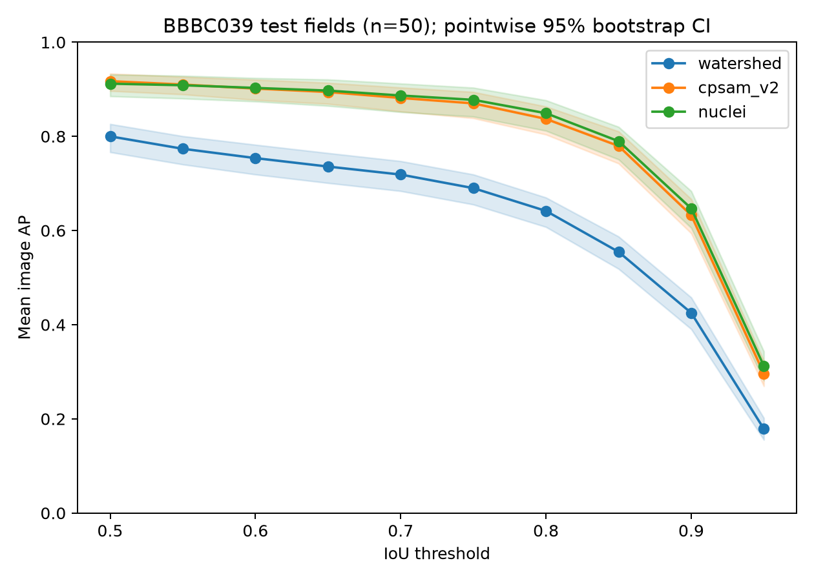

# BBBC039 segmentation comparison

All 50 official BBBC039 test fields, comparing Otsu + distance-transform watershed, CellposeSAM `cpsam_v2`, and legacy Cellpose `nuclei`. Baseline inference parameters are selected on the official training/validation splits; no model weights are fine-tuned.

Treat these scores as a comparison with possible training overlap, potentially in-distribution. Exact image-level overlap with the pretrained weights remains unresolved; see [the provenance review](TRAINING_OVERLAP.md). An independent-dataset generalisation study remains a later step.

Run on 20 October 2026. Values below are mean image scores with 95% image-bootstrap intervals. Timings are indicative local measurements after untimed warm-up, with GPU synchronization before and after inference. They include preprocessing and segmentation, and exclude model loading, process startup and I/O. Watershed uses CPU, neural methods use MPS, and legacy nuclei runs in a separate process; these are not controlled speed comparisons.

| Method | mAP 0.50–0.95 (95% CI) | F1 at 0.50 | Indicative median seconds/field | Device |
| --- | --- | --- | --- | --- |
| Otsu + watershed | 0.627 (0.598–0.651) | 0.884 | 0.05 | cpu |
| CellposeSAM cpsam_v2 | 0.792 (0.766–0.812) | 0.955 | 4.10 | mps |
| Cellpose 3 nuclei | 0.798 (0.768–0.821) | 0.951 | 0.21 | mps |

The paired test mAP differences were cpsam_v2 - watershed: 0.165 (95% CI 0.150–0.179); cpsam_v2 - nuclei: -0.006 (95% CI -0.013–0.001). Among the descriptive strata, the lowest mean mAP occurred for watershed: many touching nuclei (mAP 0.556, n=12); cpsam_v2: many touching nuclei (mAP 0.735, n=12); nuclei: many touching nuclei (mAP 0.730, n=12), which identifies associations to inspect in the image panels rather than a proven failure mechanism. The neural-model mAP difference remains uncertain on these fields; timings are indicative across CPU/GPU and processes, and unresolved pretraining overlap prevents an independent-generalisation claim.



[Full bootstrap summary](bbbc039_demo/results/summary_bootstrap.csv) · [Paired differences](bbbc039_demo/results/paired_map_differences.csv) · [Field strata](bbbc039_demo/results/failure_strata.csv) · [Hardware records](bbbc039_demo/results/hardware.json)

```bash
conda activate cell_analysis
jupyter lab BBBC039_CellposeSAM_OMEZarr_Benchmark.ipynb
```

Select **Python (cell_analysis)** and run the cells in order. The notebook converts all 200 fields for development and evaluation, ranks candidates on 100 training images, selects from the top three on 50 validation images, and evaluates the frozen choice on the 50 test images. Ties use training mAP then candidate order. Earlier fixed-parameter results used these test images, so this is a revised evaluation rather than a newly blinded experiment. Test labels do not enter parameter selection.

The selected watershed parameters are σ=0.5 pixels, minimum area=40 pixels, and peak separation=9 pixels. Its grid is σ∈{0.5,1,1.5}, area∈{20,40,80}, distance∈{5,7,9}. The selected legacy diameter is 27 pixels from {12,17,22,27,32}. The per-image search tables and selection JSON files are saved with the results. This is a finite grid search, not a claim of globally optimal parameters.

The notebook invokes [legacy_nuclei.py](legacy_nuclei.py) in `cell_analysis_legacy`. It and the notebook share [benchmark_utils.py](benchmark_utils.py), including normalisation, version-aware Zarr reads, model-file hashing and hardware records. Both helper files belong with the notebook. Set `RUN_LEGACY = False` to run only watershed and CellposeSAM.

TIFFs are converted to OME-Zarr with per-file calibration; every method reads the Zarr image. Ground truth and test predictions are stored under `labels/` in the same store. Metrics, features, plots and Napari read these arrays. The reader supports top-level multiscales metadata in NGFF 0.4 and nested ome metadata in NGFF 0.5. TIFF UIC1 headers report 0.645 µm/pixel; the BBBC022 web page gives 0.656 µm/pixel. Per-file values and their source are preserved. Nuclear features include physical area and diameter, and use the current scikit-image property `intensity_mean`. The pinned 0.26 API uses `remove_small_objects(max_size=min_area-1)` to retain components of at least `min_area` pixels.

The primary score is Cellpose-style instance AP = TP/(TP+FP+FN), at IoU 0.50–0.95 in steps of 0.05, with equal image weights. mAP averages these ten AP values and all images; it is not confidence-ranked detection AP. F1 at 0.50/0.75 and count error are secondary. Intervals use 10,000 paired bootstrap resamples of whole images, seed 7. Curve intervals are pointwise and do not account for training overlap or dependence between fields from the same experiment.

The development data includes two training fields and one validation field without annotated nuclei. Empty annotation plus empty prediction is assigned AP=1; false-positive predictions on an empty field score AP=0. All tuning scores must be finite. No test fields have empty annotations.

The decoder audit asserts identical partitions on **200/200 masks** for full-RGB connected components and the reference first-channel decoder. Thus the first channel loses no instances in these files. Full-RGB decoding is retained; repeated colours in disconnected nuclei are labelled separately.

Data and Zarr stores are saved under `bbbc039_demo/`; compact results and run records are in `bbbc039_demo/results/`. Raw data and Zarr stores are excluded from Git. Set `RUN_NAPARI = True` in the final cell for local inspection.

To recreate the pinned environments validated on macOS ARM64:

```bash
conda env create -f environment.yml
conda env create -f environment-legacy.yml
conda run -n cell_analysis python -m ipykernel install --user --name cell_analysis --display-name "Python (cell_analysis)"
```

After running the notebook, validate the saved artifacts with:

```bash
conda run -n cell_analysis python verify_benchmark.py
```

The requirements files pin direct dependencies; the lock files also pin transitive dependencies and are used by the environment files. Run records identify package versions, selected parameters, devices, hardware and weight SHA256 digests. Weights download automatically on first use.

Sources: [BBBC039v1](https://bbbc.broadinstitute.org/BBBC039), Caicedo et al. 2018; Broad Bioimage Benchmark Collection, Ljosa et al., Nature Methods, 2012 (CC0). [BBBC022 calibration](https://bbbc.broadinstitute.org/BBBC022). [Cellpose-SAM paper](https://www.biorxiv.org/content/10.1101/2025.04.28.651001v1.full). [Cellpose 4.2 models](https://cellpose.readthedocs.io/en/latest/models.html). [Legacy models](https://cellpose.readthedocs.io/en/v3.1.1.1/models.html). [scikit-image 0.26 API changes](https://scikit-image.org/docs/stable/release_notes/release_0.26.html).
